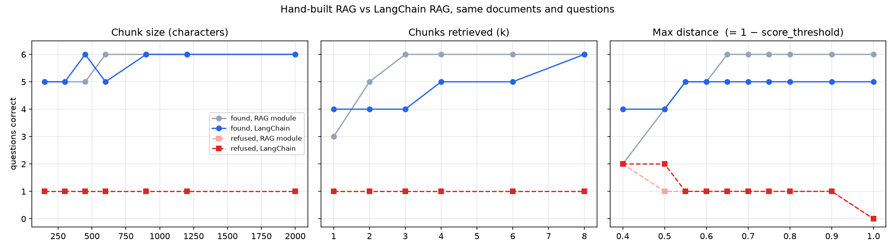

# Mini Project: Rebuild Your RAG with LangChain

**IT 7075C Applied AI for Cybersecurity** · Dharmin Patel

**GitHub project folder:** [github.com/patel5d2/rag_project/tree/main/langchain_project](https://github.com/patel5d2/rag_project/tree/main/langchain_project)

**Video walkthrough:** VIDEO LINK HERE

---

## 1. Concept check

**What problem does LangChain solve, compared with calling a model API directly?**
Calling an API directly gives you one model call; everything around it (loading files, chunking, embedding,
searching, building the prompt, parsing the reply, retrying on failure) is code you write and maintain yourself.
LangChain gives each of those jobs a standard component with the same `invoke()` interface, so they snap
together and any one can be swapped (a different model, vector store, or splitter) without rewriting the rest.

**What is a prompt template, and why use placeholders instead of a hard-coded prompt?**
A prompt template is a prompt with named slots, such as `{context}` and `{question}`, that are filled in at run
time. The instructions are written and reviewed once, and only the data changes per request. It also keeps
untrusted input (the user's question, retrieved text) in clearly marked slots instead of being concatenated
into the instructions by hand, which makes the prompt easier to test and to defend.

**What does a chain of prompt, model, and output parser do, stage by stage?**
The prompt fills its placeholders from a dictionary of values and produces a list of messages, and the model
reads those messages and returns a message object. The output parser turns that object into what the program
needs (`StrOutputParser` just extracts the text), and the pipe `|` passes each stage's output to the next.

**What is a retriever, and how does it plug into a chain?**
A retriever is any component that takes a query string and returns a list of relevant `Document`s. Here it
wraps the Chroma store with a `k` and a score threshold. In a chain it sits in the input dictionary,
`{"context": retriever | format_docs, "question": RunnablePassthrough()}`, so the question is sent to
the retriever, the documents are formatted into text, and that text fills the `{context}` slot of the prompt.

**When would you use a branch rather than running two steps in parallel? Give a security example of each.**
Use parallel steps when both results are needed and neither depends on the other, and a branch when only one
path should run, chosen by a condition. *Parallel:* when an alert arrives, look up the source IP in threat
intelligence and pull the user's recent sign-ins at the same time, then hand both to the analyst. *Branch:* my
bot (Part 7) refuses without calling the model when the retriever returns nothing, so the refusal cannot be
overridden by a model that ignores its instructions or by a prompt injection.

## 2. What I built

The same incident-response question-and-answer bot as in the RAG module, for a fictional organization's
playbook: five Markdown documents (10,104 characters) and eight gold questions, six that the documents
answer and two they do not (Q7 banana bread, Q8 a DDoS playbook that does not exist). `my_kb/` and
`goldset.json` are copies of the RAG module's files. The first cell of Part 8 hashes every file against the
originals in the repository and prints `same: True` for all six. The documents and questions are unchanged.

Parts 1–5 of the notebook are the five TODOs, practised on the course documents (23 chunks; found 5/6,
refused 2/2). From Part 8, the same pipeline runs on my documents, with the RAG module's baseline settings:
chunk size 600, overlap 100, k = 4, and a score threshold of 0.25, which is the RAG module's maximum
distance 0.75 converted (Section 5). The transcript in Part 9 shows all eight questions; Q7 is refused with
`[REFUSED] Nothing in the knowledge base is relevant enough to answer.`

## 3. What LangChain replaced

| Stage | LangChain code | Code from my RAG module notebook it made unnecessary |
|---|---|---|
| 1. Load and split | `TextLoader(...).load()`, `RecursiveCharacterTextSplitter(...).split_documents()` | `split_into_chunks()`, the `while start < len(text)` window loop, and `load_and_chunk()` with its parallel `sources` list |
| 2. Vector store | `HuggingFaceEmbeddings(...)`, `Chroma.from_documents(...)` | `embed()`, `chromadb.EphemeralClient()`, `build_collection()` and `collection.add(ids=, documents=, embeddings=, metadatas=)` |
| 3. Retriever | `store.as_retriever(search_type="similarity_score_threshold", search_kwargs={"k", "score_threshold"})` | `retrieve()`: `collection.query()`, unpacking `results["documents"][0]` etc., and the `if dist <= max_distance` filter |
| 4. Prompt template | `ChatPromptTemplate.from_messages([("system", ...{context}), ("human", "{question}")])` | the `SYSTEM` string and `SYSTEM.format(context=...)`. `build_context()` survives almost unchanged as `format_docs()` |
| 5. Chain | `{"context": retriever \| format_docs, "question": RunnablePassthrough()} \| prompt \| model \| StrOutputParser()` | `ask()` and `generate()`, including the OpenAI client call and the `_USE_API` fallback flag, now `ChatOpenAI(...).with_fallbacks([offline])` |

The metadata bookkeeping disappeared completely: the loader puts the file path in `metadata["source"]` and the
splitter copies it onto every chunk, where I used to keep a separate list in step with the chunks. Scoring
(`found`/`refused`) is still my own code; LangChain has no idea what my gold set is.

## 4. Where the framework helped and where it hid something

**It helped** with plumbing. The pipeline is shorter, each stage is swappable (adding an LLM is one line and
falls back automatically when the key fails), and the branch-based refusal in Part 7 was easy to add.

**It hid three things that changed my results or could have.**

1. **How chunk boundaries were chosen.** My hand-written splitter cut fixed 600-character windows. The
   `RecursiveCharacterTextSplitter` first tries to split on blank lines, then on newlines, then spaces, and
   only builds its overlap from whole pieces that fit in 100 characters. I never wrote that rule and could not
   see it until I printed the chunks. It produced 25 chunks instead of 22, and it is the reason for this
   version's one extra miss (Section 7). It mattered *both* ways: section-aligned chunks moved the evidence for
   Q1 and Q6 to rank 1 (in the RAG module they were rank 2 and rank 3, Q6 because a window had cut off the
   word "kept"), but it buried Q3's.
2. **How a score was computed.** The retriever returns `Document`s with no score attached. To see why a chunk
   was kept, I had to bypass it and call `similarity_search_with_relevance_scores()`. The relevance score is
   computed from the distance by a function LangChain picks based on the store's metric: `1 − distance` for
   cosine. Chroma's default metric is L2, for which LangChain uses a different formula. If I had forgotten
   `collection_metadata={"hnsw:space": "cosine"}`, every threshold would have meant something else and
   nothing would have warned me. Part 3 asserts `relevance == 1 − distance` so the conversion is checked.
3. **What happens on an empty result.** When nothing passes the threshold, the retriever quietly returns an
   empty list and writes a line to a logger. That empty list *is* my refusal signal, so the refusal path
   depends on a behaviour I did not write.

**When it matters.** For a security team this is an auditing problem. If the bot gives an analyst the wrong
containment step during an incident, the post-incident review needs to know which chunk was retrieved, at what
score, and why the correct one was not. The defaults hide exactly those facts. It also matters whenever the
framework is upgraded: a change to the default separators or score function would change behaviour without any
change to my code. (While building this, `langchain-community`, which provides `TextLoader`, printed a notice
that it is being sunset.)

## 5. The numbers

LangChain keeps hits whose **relevance is at least** the threshold; the RAG module kept hits whose **distance
was at most** the threshold. For cosine, relevance = 1 − distance, so `score_threshold = 1 − max_distance`,
and the threshold sweep below uses the RAG module's exact values converted. The like-for-like row is
**600 / 100, k = 4, max distance 0.75 = score threshold 0.25.** Full results are in `results_langchain.csv`
(25 configurations).

| Setting changed | Value | RAG module found / refused | LangChain found / refused |
|---|---|---|---|
| **like-for-like baseline** | 600, k 4, 0.75 ↔ 0.25 | **6 / 1** | **5 / 1** |
| chunk size | 150, 300 | 5 / 1 | 5 / 1 |
| chunk size | 450 | 5 / 1 | 6 / 1 |
| chunk size | 900, 1200, 2000 | 6 / 1 | 6 / 1 |
| k | 1 | 3 / 1 | 4 / 1 |
| k | 2, 3 | 5, 6 / 1 | 4 / 1 |
| k | 6 / 8 | 6 / 1 | 5 / 1, **6 / 1** |
| max distance (score threshold) | 0.40 (0.60) | 2 / 2 | 4 / 2 |
| max distance (score threshold) | 0.50 (0.50) | 4 / 1 | 4 / **2** |
| max distance (score threshold) | 0.55–0.60 (0.45–0.40) | 5 / 1 | 5 / 1 |
| max distance (score threshold) | 0.65–0.90 (0.35–0.10) | 6 / 1 | 5 / 1 |
| max distance (score threshold) | 1.00 (0.00) | 6 / 0 | 5 / 0 |
| splitter, at baseline | `CharacterTextSplitter(separator="")` | — | **6 / 1** (21 chunks) |

**Why they differ.** Same documents, same embedding model, same question vectors: every difference comes from
the chunks. The splitter row proves it. Switching to a fixed-window `CharacterTextSplitter` brings LangChain
back to 6 / 1, with every question's nearest distance identical to the RAG module's to three decimal places. With the recursive splitter,
the rank of each question's evidence chunk changed: Q1, Q2, Q5, Q6 at rank 1 (distance ≤ 0.371), Q4 at rank 4
(0.518), and Q3 at rank 8 (0.725). That explains each sweep:

- **k:** with k = 1 LangChain finds 4 against 3, because Q1 and Q6 moved up to rank 1. But it needs k = 4 for
  Q4 and k = 8 for Q3, where the RAG module had everything by k = 3.
- **Threshold:** at max distance 0.40 LangChain finds 4 against 2, again because four evidence chunks are closer
  than 0.371. Above 0.55 it is stuck at 5 however loose the threshold, because Q3's evidence is not in the top
  four at all; a looser threshold cannot add a chunk that k already cut off.
- **Refusals:** at 0.50, LangChain refuses Q8 and the RAG module did not. Q8's nearest chunk is at distance
  0.512 here (relevance 0.488) against 0.494 before, because the phishing playbook header is now a short
  216-character chunk of its own. That is just past 0.50, which costs nothing here since Q3's evidence is out
  of reach anyway.

Both versions peak at 7 / 8, and in both Q8 is never refused at any setting that finds all six answers.

## 6. Which version I would build next time

For anything I would hand to other people, **LangChain**: the components are standard, the LLM, vector store, or
embedding model can be replaced in one line, and features like fallbacks and branching come free. But I would
not accept its defaults blindly. I would choose the splitter on purpose and check it against the gold set, and
log `similarity_search_with_relevance_scores()` next to every answer so each answer can be traced back to its
chunks and scores. For **evaluation, teaching, or an audited security tool** where every retrieval decision
has to be explained, I would build it by hand, or at least keep a hand-written retrieval step: it is only a few
dozen lines, and every number in it is one I can point to.

## 7. One question this version got wrong: Q3

> **Q3:** "A user typed their password into a phishing page. How far back should we review their sign-in logs?"
> Evidence: "Review sign-in logs for the last 14 days". The RAG module found it; LangChain did not.

**What it retrieved instead.** All four chunks came from the right file, `03_phishing_playbook.md`, but none
held the answer: the *Closure* section (relevance 0.490), *Containment* (0.429), the playbook header (0.403),
and *Triage* (0.365). The chunk with the evidence came **eighth**, at relevance 0.275.

**The mistake.** The playbook reads:

> **If credentials were entered.** Treat any user who typed a password into the phishing page as a compromised account. The response is SEV2 at minimum.
> 1. Reset the user's password … 3. Review sign-in logs for the last 14 days …

The recursive splitter broke at the blank line before the numbered list. The heading and the sentence "typed a
password into the phishing page", which match the question almost word for word, ended up at the end of the
*Containment* chunk, while the steps went into the next chunk. The 100-character overlap did not rescue it:
the recursive splitter only overlaps whole pieces, and that sentence is about 120 characters, so nothing was
carried over. The evidence chunk therefore starts with "1. Reset the user's password…" and has lost
everything that says *when* these steps apply, so it looks like a generic list to the embedding model. The
fixed-window splitter happened to start its chunk at "password into the phishing page…" and kept the two
together, scoring 0.483 (Part 12 prints both side by side).

So it is not a retrieval error in the usual sense. The answer exists, but the chunk holding it no longer holds
the words of the question. **Fixes:** a larger overlap or larger chunks (chunk size 450 or 900 both find it),
splitting on Markdown headings so each section stays whole, or k = 8. Q8 remains wrong in both versions for
the reason given in my RAG report: the playbook header is generically similar to any "steps in our playbook"
question, and a vector distance cannot insist that the word "DDoS" appear.

## 8. Limitations

Six answerable and two unanswerable questions mean every difference here is one question; the 6-vs-5 baseline
gap is Q3 alone. I wrote both the documents and the questions. "Found" measures retrieval, not answers: the
notebook ran in offline mode, so I did not test whether an LLM would use the retrieved chunks correctly.
