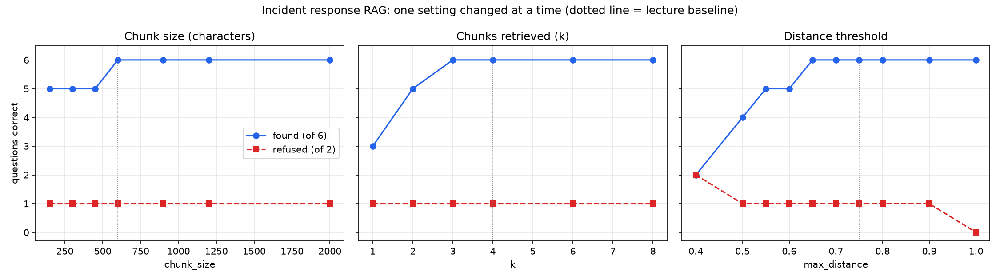

# Mini Project: Build a RAG System for Your Own Data

**IT 7075C Applied AI for Cybersecurity** · Dharmin Patel

**GitHub project folder:** [github.com/patel5d2/rag_project](https://github.com/patel5d2/rag_project)

**Video walkthrough:** [Watch the video on SharePoint](https://mailuc-my.sharepoint.com/:v:/g/personal/patel5d2_mail_uc_edu/IQCdUnekw9t8TYws3_kmg02nAa4j9jCkLgGce7JcA3DKTEs?nav=eyJyZWZlcnJhbEluZm8iOnsicmVmZXJyYWxBcHAiOiJTdHJlYW1XZWJBcHAiLCJyZWZlcnJhbFZpZXciOiJTaGFyZURpYWxvZy1MaW5rIiwicmVmZXJyYWxBcHBQbGF0Zm9ybSI6IldlYiIsInJlZmVycmFsTW9kZSI6InZpZXcifX0%3D&e=TrV4Qu)

---

## 1. How my RAG system works

A large language model only knows what was in its training data. It has never seen my organization's
incident response playbook, and if I ask it how quickly a SEV1 must be acknowledged, it will make up
a plausible number. Retrieval-augmented generation (RAG) fixes this by finding the relevant passages
in my own documents first and handing them to the model with the question. The model then answers
from that text instead of from memory.

**Embeddings.** An embedding model turns a piece of text into a fixed-length list of numbers, a vector.
I use `all-MiniLM-L6-v2`, which runs locally on the CPU and produces 384 numbers per text. The model
was trained so that texts with similar *meaning* end up close together in that 384-dimensional space,
even when they share no words. "How fast must we respond to a critical incident?" lands near
"Acknowledge within 15 minutes, at any hour", although the two have almost no words in common.
That is what makes search by meaning possible: I embed the question and look for the chunks whose
vectors are closest. I normalize every vector and measure closeness with **cosine distance**, where
0 means identical direction and 1 means unrelated. The same model must embed both the chunks and the
question, or the distances mean nothing (notebook Part 1, `embed()`).

**Chunking.** A whole document cannot go in as one vector. One vector cannot represent ten topics at once, and
the model would receive far more text than the question needs. So each document is cut into
overlapping pieces (notebook Part 1, `split_into_chunks()`, TODO 1). I use 600 characters with a
100-character overlap, so a sentence that falls on a boundary still appears whole in one of the two
neighboring chunks. Chunk size is a trade-off:

- **Too small** and a chunk holds a fragment without its context. Several near-identical fragments
  compete for the top places, and the one that actually holds the answer can be pushed out. My
  experiments show exactly this (Section 3).
- **Too large** and one chunk mixes several topics. Its vector becomes an average of all of them, so
  it matches nothing strongly. The prompt also fills with irrelevant text that the model has to
  read past. In a tiny knowledge base, very large chunks mean that retrieving four of them returns
  most of the documents, which is no longer retrieval at all.

**The vector database.** ChromaDB stores, for every chunk, an ID, the chunk text, its embedding, and
metadata recording which file it came from (Part 2, `build_collection()`, TODO 2). The collection is
configured for cosine distance. Given a question vector, it returns the *k* nearest chunks with their
texts, distances, and metadata. It always returns *k* results, however irrelevant, so my
`retrieve()` function also drops any hit farther than `max_distance` (Part 3, TODO 3). An empty
result is the signal that the documents do not cover the question.

**The three steps of RAG.** `ask()` in Part 4 runs all three:

1. **Retrieve.** Embed the question and get the closest chunks that pass the threshold (`retrieve()`).
2. **Augment.** Paste those chunks, each labeled with its source file, into the system prompt, which
   tells the model to answer only from that context, cite the file, and say it does not know when
   the context is empty (`build_context()`, TODO 4, and the `SYSTEM` prompt).
3. **Generate.** Send the prompt to the language model (`generate()`). Without an API key the notebook
   runs in offline mode and quotes the retrieved context. Every number in this report comes from
   retrieval and does not depend on an LLM.

Part 5 (`score()`, TODO 5) measures the pipeline with two counts: **found**, how many answerable
questions retrieved a chunk containing the exact evidence phrase, and **refused**, how many
unanswerable questions retrieved nothing. On the course documents my implementation gives the
expected **22 chunks, found 6/6, refused 2/2**.

## 2. What I built

**Topic.** I chose incident response because it suits this kind of test: playbooks are full of
precise, checkable facts (who decides, how fast, which tool, how long), and an analyst in the
middle of an incident really does need to look these up quickly.

**Documents.** I wrote five Markdown documents (10,104 characters) describing a fictional
organization's program. Their structure follows NIST SP 800-61, the CISA ransomware guidance, and
RFC 3227, all paraphrased, and `my_kb/SOURCES.md` records this.

| File | Content | Chars |
|---|---|---|
| `01_ir_overview.md` | lifecycle phases, how to report, team roles | 2,385 |
| `02_severity_levels.md` | SEV1–SEV4 definitions, response times, escalation | 1,855 |
| `03_phishing_playbook.md` | triage, containment, compromised credentials | 1,909 |
| `04_ransomware_playbook.md` | first 30 minutes, scoping, recovery, payment policy | 2,065 |
| `05_evidence_handling.md` | order of volatility, imaging, chain of custody, retention | 1,890 |

**Questions.** `goldset.json` holds eight questions. Each answerable one has an evidence phrase copied
word for word from its document. The notebook's first Part 6 cell checks that every phrase really
appears in the stated file, on one line and under 80 characters, and all six pass.

| ID | Question | Evidence phrase |
|---|---|---|
| Q1 | Who has the authority to declare a security incident closed? | "The Incident Commander is the only person who can declare an incident closed." |
| Q2 | How quickly do we have to acknowledge a critical SEV1 incident? | "Acknowledge within 15 minutes, at any hour." |
| Q3 | A user typed their password into a phishing page. How far back should we review their sign-in logs? | "Review sign-in logs for the last 14 days" |
| Q4 | What should we do with the backup servers when ransomware is detected? | "Take the backup servers offline from the production network" |
| Q5 | How do we prove a forensic disk image is an exact copy of the original drive? | "Calculate a SHA-256 hash of the original and of the image" |
| Q6 | How long are security logs retained? | "kept for one year online and an additional six years in archive" |
| Q7 | What is a good recipe for banana bread? | (unanswerable, off topic) |
| Q8 | What are the steps in our playbook for responding to a DDoS attack against our website? | (unanswerable, sounds right) |

I phrased the questions the way an analyst would ask them, not as keyword searches. Q5, for example,
never says "SHA-256" or "hash".

**Why Q8.** Q7 is easy to refuse because nothing in the documents is about baking. Q8 is the real test. It is
phrased exactly like my other questions, it uses the playbook's own vocabulary ("steps", "playbook",
"responding", "attack"), and a DDoS playbook is something an incident response plan would very
plausibly contain. But mine does not: the word "DDoS" appears nowhere in `my_kb/`. A system that
answers Q8 is inventing a procedure, which in a real incident is worse than saying "I don't know".

## 3. What my experiments showed

I started from the lecture settings (chunk size 600, overlap 100, k = 4, threshold 0.75) and changed one
setting at a time, scoring each configuration on all eight questions. The 23 configurations are in
`results.csv`; the chart is `figure.png`.

| Setting changed | Values tried | Found (of 6) | Refused (of 2) |
|---|---|---|---|
| chunk size | 150, 300, 450 | 5 | 1 |
| chunk size | 600, 900, 1200, 2000 | 6 | 1 |
| k | 1 / 2 / 3–8 | 3 / 5 / 6 | 1 |
| threshold | 0.40 | 2 | **2** |
| threshold | 0.50 | 4 | 1 |
| threshold | 0.55–0.60 | 5 | 1 |
| threshold | 0.65–0.90 | 6 | 1 |
| threshold | 1.00 | 6 | **0** |

**The distance threshold mattered most.** It is the only setting that moved refusals at all, and it
moved found from 2 to 6. Chunk size and k only ever affected found. The threshold is the setting that
trades answers for refusals. At 1.0 the system finds everything but refuses nothing, even the banana
bread question: it has started guessing. At 0.40 it refuses both but finds only two answers.

The cell after the chart shows why no threshold gets 8/8. It sorts the questions by the distance to their
nearest chunk:

| Q4 | Q2 | Q1 | Q6 | Q5 | **Q8** | Q3 | Q7 |
|---|---|---|---|---|---|---|---|
| 0.279 | 0.339 | 0.373 | 0.394 | 0.474 | **0.494** | 0.498 | 0.914 |

The sounds-right question Q8 sits *inside* the answerable range, closer than Q3. Any threshold that
lets Q3 through also lets Q8 through. Distance alone cannot separate them.

**k:** with k = 1 only three questions find their evidence. For Q1 and Q3 the evidence is in the
second-closest chunk, and for Q6 in the third. Q6 is a chunk-boundary effect: its closest chunk starts
mid-sentence at "for one year online and an additional six years…". It has the answer, but it cut off the
word "kept", so it does not contain the full evidence phrase. The intact phrase sits in the overlapping
previous chunk at rank 3 (distance 0.616). From k = 3 onward everything is found.

**Chunk size:** at 450 characters and below, Q4 fails. The ransomware playbook splits into more pieces, and
the chunk about *restoring* data from backups (distance 0.280) outranks the one that says to *take the
backup servers offline*. Both mention backups, and the correct chunk drops out of the top four.

**Settings I would use:** chunk size 600 with overlap 100, k = 4, and threshold **0.65**. That is the
tightest threshold that still finds all six answers. It refuses exactly as well as 0.75 on my set, and
it keeps weaker, noisier chunks out of the prompt. k = 3 also scores 7/8, but k = 4 leaves margin for
questions phrased differently from mine. None of these settings refuses Q8, and that has to be
handled differently (Section 4).

## 4. A question my system got wrong: Q8

At the recommended settings, Q8 ("What are the steps in our playbook for responding to a DDoS attack
against our website?") retrieved four chunks instead of none. The closest, at distance 0.494, is:

> `03_phishing_playbook.md`: "# Playbook: Phishing Email ## Trigger  This playbook starts when a
> user reports a suspicious email…"

The next three are the ransomware playbook's header (0.561) and two more phishing chunks.

**Why.** The embedding of a chunk captures what kind of text it is as much as its specific facts. The
header of a playbook is generic: "Playbook", "Trigger", "this playbook starts when…". The question asks
for "the steps in our *playbook* for *responding* to an *attack*", which is a near-perfect match for
that general shape. The one word that makes the question unanswerable, "DDoS", is a single token
among many, and the 384-number vector of a short sentence has no way to insist that it must appear.
Retrieval answers "which text is most like this question?", never "does this text actually contain
the answer?". The system did not misunderstand the topic. It found the most similar text, and similar
was not enough.

**What would fix it.** Tuning the threshold cannot, as Section 3 shows. Three options:

1. **Let the generation step refuse.** The prompt already says to answer only from the context. A real LLM
   reading two phishing chunks and a ransomware chunk would very likely say the context does not cover
   DDoS. My offline mode cannot judge relevance, so I could not measure this without an API key.
2. **Hybrid search.** Combine the vector distance with keyword matching (for example BM25), so a question
   whose distinctive terms appear nowhere in the documents is refused.
3. **A cross-encoder re-ranker**, which reads the question and the chunk together and scores whether the
   chunk answers the question, instead of comparing two separately computed vectors.

## 5. What my evidence does not tell me

- **The sample is tiny.** With six answerable questions, each one is 17% of the found score, and with two
  unanswerable ones, each is 50% of the refused score. Most of my curves move in steps of one question.
  The difference between threshold 0.60 and 0.65 is a single question (Q6, whose evidence chunk sits at
  0.616), so I would not claim that 0.65 is reliably better. It is better *on these eight questions*.
- **I wrote both the documents and the questions.** My questions inevitably echo my documents' vocabulary.
  A real analyst under pressure would phrase things differently, and real playbooks are messier, so
  real-world retrieval would probably be worse than my numbers suggest.
- **"Found" measures retrieval, not answers.** It only checks that the evidence phrase reached the
  prompt. It says nothing about whether an LLM would use it correctly, cite it properly, or ignore the
  three irrelevant chunks next to it. In offline mode I never tested generation at all.
- **One near-miss question.** Refused = 1/2 everywhere tells me Q8 fails, not how often near-miss questions
  fail in general. With five sounds-right questions I might see that some are refused and some are not.
- **One embedding model, one tiny knowledge base.** 22 chunks means k = 4 already retrieves 18% of
  everything. The best settings for a knowledge base of thousands of chunks, or for a stronger
  embedding model, could be quite different.
- **Exact-string scoring.** A chunk can contain the right answer and still be scored as a miss. Q6's closest
  chunk holds the answer but has lost the word "kept" to a chunk boundary. Matching is case-insensitive
  but otherwise literal.
